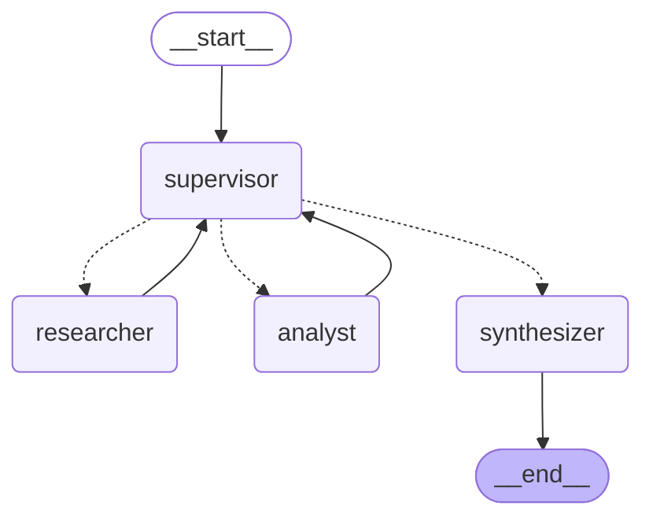

# Orquestador Multi-Agente (LangGraph + Gemini)

Pre-entrega 6 — Curso AI Engineering (CoderHouse).

Sistema jerárquico con un **Supervisor** que delega en dos especialistas (investigación y análisis)
y cierra con un nodo **Synthesizer**. Modelo: `gemini-3.8-flash`. Búsqueda web: Tavily.

## Diagrama del grafo



Las líneas punteadas son aristas condicionales (decide el supervisor); las sólidas son fijas.

## Topología y por qué

**Estrella con supervisor central.** Solo el supervisor decide el flujo; los especialistas siempre
reportan de vuelta a él y el único camino hacia `END` pasa por el `synthesizer`.

- Un único punto de decisión facilita aplicar la rúbrica de validación y el tope de pasos.
- Los especialistas no se conocen entre sí: no hay conflictos de control ni bucles cruzados.
- Cada especialista tiene herramientas acotadas (Tavily para investigar; cálculo determinista para analizar).

## Estado compartido (`state.py`)

`OrchestratorState` hereda de `MessagesState` y agrega:

| Campo | Rol | Combinación |
|---|---|---|
| `next_agent`, `instruction` | decisión del supervisor y orden específica | sobrescribe |
| `step_count`, `task_completed` | control y parada | sobrescribe |
| `research_output`, `analysis_output` | salidas estructuradas (Pydantic) | sobrescribe (al refinar) |
| `contributions` | registro de quién aportó qué | acumula (`operator.add`) |

Los contratos de datos viven en `schemas.py`.

## Manejo de conflictos y condiciones de parada

- **Rúbrica en el prompt del supervisor**: valida `sufficient` (investigación) y `data_quality_ok` (análisis) antes de cerrar.
- **Guardas en código** sobre la decisión del LLM: no se puede ir al analista sin investigación ni al synthesizer sin ambas salidas.
- **Conflicto investigador ↔ analista**: si el analista marca `data_quality_ok=False`, el supervisor re-delega al investigador con una instrucción más precisa.
- **Anti-bucle**: `MAX_STEPS = 6` fuerza el cierre con lo disponible (e indica sus límites); además `recursion_limit=30`.
- **Contexto acotado**: cada especialista recibe solo la instrucción (y, el analista, los hallazgos), no el historial.

## Estructura

```
state.py  schemas.py  llm.py  graph.py  main.py
agents/   research_agent.py  analyst_agent.py  supervisor.py
tools/    math_tools.py
```

## Ejecución

```bash
python -m venv .venv
source .venv/bin/activate        # Windows: .venv\Scripts\activate
pip install -r requirements.txt
cp .env.example .env             # Windows: copy .env.example .env  (y completa las claves)
python main.py
```

Pruebas por separado: `python test_research.py`, `python test_analyst.py`.
Regenerar el diagrama: `python make_diagram.py`.
